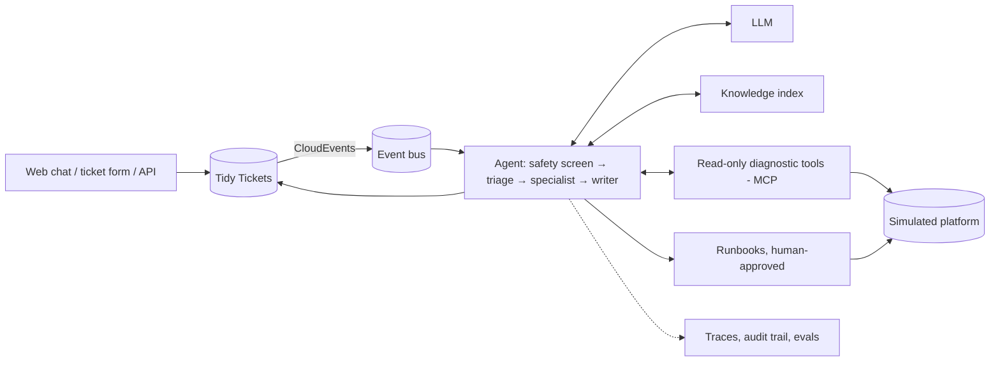

# Tidy architecture

Tidy is built and deployed on Google Cloud. Its core does not depend on Google
Cloud: each infrastructure concern sits behind a port with a local adapter (used
by every test) and a GCP adapter (deployed). An AWS or Azure adapter implements
the same port and must pass the same contract tests.

## Boundaries

- **Synthetic data only**, including prompts sent to the model. The free Gemini
  API tier may use prompts to improve Google's products.
- **No medical advice.** No dosing advice, no setting recommendations, no alerts.
- **Potential complaints go to a human.** A ticket that suggests a device
  malfunction or harm is flagged, handed off at once, and can't be resolved by
  the agent.
- **No write-back** to any real platform or device. Runbooks act on the simulator.

## Components

- **Tidy Tickets:** lite ticketing with `SUP` and `ENG` queues, an enforced
  state machine, approvals, and a hash-chained append-only audit trail. A
  server-rendered console shows queues, tickets, agent traces, the audit log and
  eval results.
- **Agent:** Google ADK. Code-driven diagnostic playbooks gather evidence; the
  model chooses an action and explains it. About three model calls per ticket.
- **Knowledge:** articles written for this project, plus reviewed summaries of
  resolved synthetic tickets. Replies cite article IDs.
- **Simulator:** generated accounts, devices, uploads and logs, with injected
  faults and labeled tickets for evaluation.

## Ports and platform mapping

| Port | Local (tests) | GCP (built) | AWS (notes) | Azure (notes) |
|---|---|---|---|---|
| Hosting | uvicorn | Cloud Run | App Runner / ECS Fargate | Container Apps |
| `LLM` | Scripted, record/replay | Gemini API | Bedrock | AI Foundry / Azure OpenAI |
| `Secrets` | Env vars, Keychain | Secret Manager | Secrets Manager | Key Vault |
| `EventPublisher` | In-process | Pub/Sub | SNS + SQS / EventBridge | Service Bus / Event Grid |
| `TicketStore` | SQLite | Firestore | DynamoDB | Cosmos DB |
| `KnowledgeIndex` | BM25 | BigQuery vector search | Bedrock Knowledge Bases / OpenSearch | Azure AI Search |
| `PlatformData` | DuckDB | BigQuery | Athena / Redshift Serverless | Fabric / Synapse |
| `LogSearch` | JSON lines | Cloud Logging | CloudWatch Logs Insights | Log Analytics |
| `RunbookRunner` | Python | Cloud Workflows | Step Functions | Logic Apps / Durable Functions |
| `ObsStore` | SQLite | BigQuery + Cloud Trace | X-Ray + Athena | Azure Monitor |
| Service identity | — | Service accounts, OIDC | IAM roles | Managed identities, Entra ID |

Choices that keep porting cheap:

- CloudEvents for every event.
- OpenTelemetry for traces.
- OIDC bearer tokens.
- MCP for tools.
- One neutral runbook format with per-cloud translators.
- Ticket-store queries limited to key, queue/status, scope and time.

## Models

Callers request a role, never a model ID. The target file maps roles to models
with client-side limits:

- `agent` → a Flash Lite model, with a second Flash Lite model as fallback.
- `support` → the second Flash Lite model (grading wording, summarizing).
- `judge` → a Flash model, for a small daily sample.

The adapter enforces requests per minute and per day, keeps a reserve that batch
work cannot use, retries per-minute 429s, and marks a model exhausted on a
per-day 429. When no model is left, the caller hands off; it never guesses. CI
never calls a live model: it replays recorded synthetic exchanges.

## Phases

| Phase | Delivers |
|---|---|
| 0 | Ports, local adapters, Gemini adapter with quota handling, health service, CI |
| 1 | Platform simulator, fault injector, labeled ticket generator |
| 2 | Tidy Tickets with audit trail and console |
| 3 | Knowledge base |
| 4 | Diagnostic tools, agent in draft-only mode, tracing |
| 5 | Eval harness, improvement loop, autonomous replies for safe categories |
| 6 | Runbooks with approvals |
